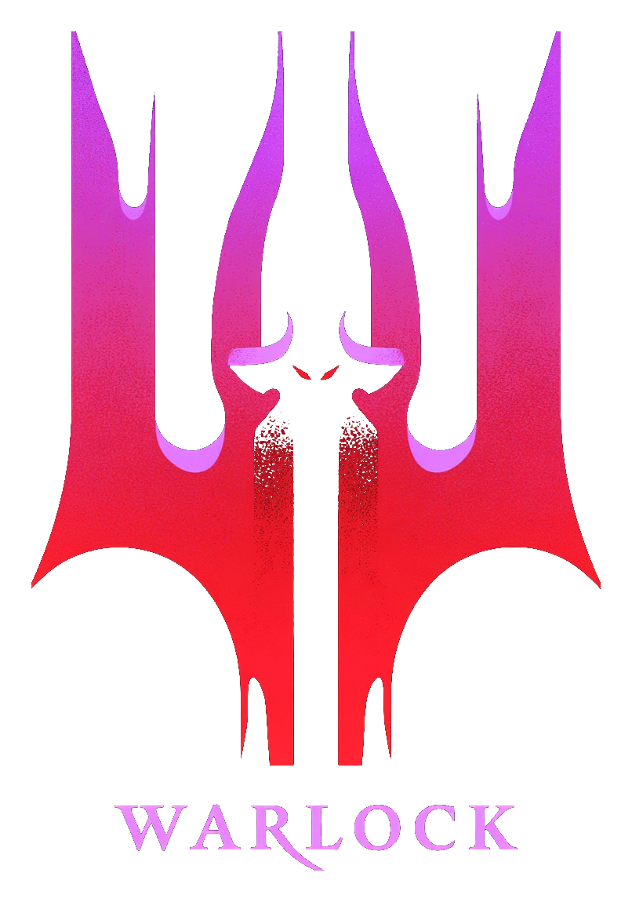
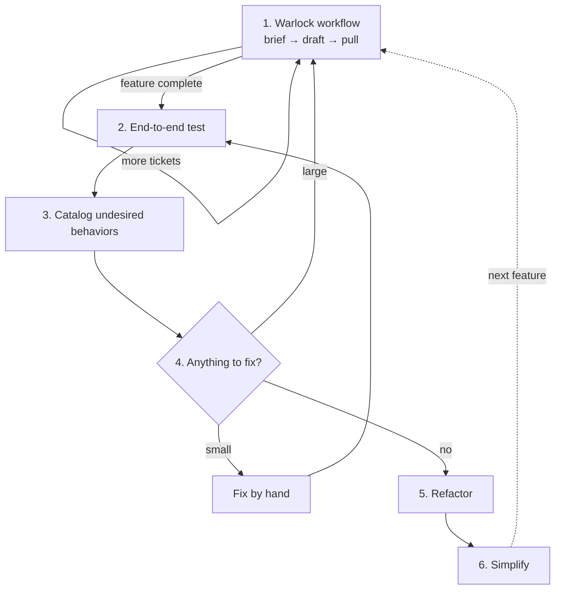

<p align="center">
  
</p>

<p align="center"><strong>AI works only inside the scopes your team draws.</strong></p>

<p align="center">
  <a href="https://github.com/Genetic-Pottery/warlock/actions/workflows/ci.yml"></a>
  <a href="https://github.com/Genetic-Pottery/warlock/blob/main/LICENSE"></a>
  <a href="https://code.claude.com/docs/en/plugins"></a>
  <a href="https://github.com/Genetic-Pottery/warlock/releases/latest"></a>
</p>

---

> **warlock** *(n.)* one who draws power from a pact with an entity greater than themselves.

Warlock is a Claude Code plugin for teams that share a repository. Each team owns
a set of directories, called a *scope*, linked to its Linear team or Jira
project. An agent works from a ticket, and it can change only the files in that
ticket's team scope. An agent on a data-plane ticket can't refactor the
control-plane code, even though both live in one monorepo.

To set up a repository from scratch, see [Get started](GETTING-STARTED.md).

## How it holds

Warlock enforces scopes at three points. Each catches what the one before it
misses.

| Point | Runs | Catches |
|---|---|---|
| Gate hook | Before every `Edit` or `Write` | A file write outside the ticket's scope. The write never happens. |
| Stop hook | When the agent tries to finish | Shell writes (`sed`, heredocs) and commits outside the scope. The agent must revert them or halt. |
| CI check | On every pull request `/warlock:pull` opens | Anything that reached a PR: no ticket, files outside scope, or a skipped PR template section. |

The hooks run on each developer's machine, and anyone can turn them off with
`WARLOCK_GATE=off`. The CI check is the one you can make mandatory: mark it a
required status check in branch protection. It reads the scopes from the base
branch, so a pull request can't widen its own scopes.

Warlock guards AI work, not people. Your own edits and pull requests are never
checked. Claude changes scoped code only through `/warlock:pull`: outside it,
Claude can read, explain, and plan, but the gate refuses its edits to scoped
files. To use Claude without Warlock, start it with `WARLOCK_GATE=off`, or don't
install the plugin.

## Workflow

The plugin adds four skills:

1. `/warlock:init` maps your directories to teams, then writes
   `.warlock/scopes.toml`, the PR template, and the CI workflow.
2. `/warlock:brief` questions a feature idea until it holds up, writes a brief,
   and pushes it to Linear as a project or to Jira as an epic.
3. `/warlock:draft` cuts a brief into tickets, one team per ticket, with
   `blocked by` links between them.
4. `/warlock:pull` takes the next unblocked ticket assigned to you and ends in
   one of two outcomes:
   - **Finished:** a pull request is open and the ticket is in review.
   - **Halted:** the ticket needs a person. It has a comment with the reason,
     and no pull request is open.

Pull cuts the ticket into sub-tasks and posts the plan as a ticket comment. Each
sub-task runs in a fresh subagent, so a 30-minute ticket doesn't run on one
filling context. Each finished sub-task is committed as `KEY.N: goal` and
pushed. If a run crashes, hits a limit, or pauses on a transient failure, the
next pull resumes it at the first unfinished sub-task, on any machine. The queue
skips a halted ticket until someone pulls it by key.

Briefs, tickets, and pull requests follow templates. To change a brief or ticket
template, copy it from `templates/` into your repository's `.warlock/templates/`.
The PR template is `.github/pull_request_template.md`, and CI requires each of
its `## ` headings in the PR description.

## Working in rounds

A feature takes many rounds of brief, draft, and pull. Build the feature with
Warlock, then test it end to end before you clean it up. Fix small problems by
hand, and send large ones back through Warlock as new tickets.

After each round, you're one step closer to where you want to be. At a good
resting point, ask:

- Am I going in the right direction, or should I change course?
- Does this feel good to use, or is it hacky?
- Are there bugs?

You won't land on a finished product in one pass. You approach it, and adjust
your mental model as you go. That's how people built software before AI, too.



For refactoring, I recommend the `improve-codebase-architecture` skill from
[Matt Pocock's skills](https://github.com/mattpocock/skills). For simplifying,
I recommend Claude Code's built-in `/simplify`, pointed at all the code rather
than only recent changes.

## Requirements

- Claude Code
- Python 3.11 or later, and `git`
- `gh`, signed in, for `/warlock:pull`
- The Linear MCP server, the Atlassian MCP server, or both, connected in Claude
  Code. Warlock keeps no API keys.

## Install

```sh
claude plugin marketplace add Genetic-Pottery/warlock
claude plugin install warlock@warlock
```

Then, in your repository, run `/warlock:init`.

## Scopes

`.warlock/scopes.toml` lists one `[[scope]]` per team area:

```toml
base = "main"

[[scope]]
name = "data-plane"
paths = ["services/data-plane"]
tracker = "linear"
team = "DP"

[[scope]]
name = "shared"
paths = ["libs/proto", "Cargo.lock"]
tracker = "linear"
team = "PLAT"
shared = true
```

The rules are as follows:

- A path belongs to the scope with the nearest matching entry in `paths`.
- A path that no scope covers is closed to AI work.
- A scope with `shared = true` is open to any team's ticket.
- `.warlock/` is closed to agents. A person edits it.

Settings at the top of the file are defaults, and any scope can override them:

| Setting | Default | Controls |
|---|---|---|
| `base` | `main` | The branch work starts from and pull requests target |
| `label` | `warlock` | The label that marks tickets an agent may pull |
| `start_state` | `In Progress` | Ticket state while an agent works it |
| `review_state` | `In Review` | Ticket state once its pull request is open |
| `project_start_state` | `In Progress` | Project or epic state once its tickets are drafted |
| `project_review_state` | `In Review` | Project or epic state once every ticket is in review or done |

One setting applies to the whole manifest, and no scope can override it:

| Setting | Default | Controls |
|---|---|---|
| `project_branches` | `false` | When `true`, a ticket targets the project branch its description names instead of `base` |

With `project_branches` on, each project gets its own branch,
`project/<slug>`, and several projects can be open at once. A project's work
reaches `base` only when a person merges its branch. The branch works like
this:

- Draft writes `project/<slug>` into a `## Project branch` section of each
  ticket, from the brief's title. Renaming the project later doesn't change it.
- Pull targets the branch the ticket names, and creates it from `base` the
  first time a ticket needs it.

Pull reads the branch from the ticket, not from its parent, because Jira
refuses an epic as the parent of a ticket in another team's project.

Linear has no `In Review` project status by default. Add one in Linear's
settings, or set `project_review_state` to a status you have.

To see the resolved settings, run `warlock.py scopes --json`. For every field,
see [`templates/scopes.toml`](templates/scopes.toml).

## Command line

The hooks and CI run `scripts/warlock.py`. You can run it yourself:

```sh
python3 scripts/warlock.py scopes          # validate the manifest and list scopes
python3 scripts/warlock.py where FILE...   # which scope covers each file
python3 scripts/warlock.py check           # changes this branch's ticket may not make
```

## Limits

The hooks guard the files in your repository. They don't stop an agent from
running `git push` or `gh` itself. On a machine with no person watching, give the
agent a token that can't push to protected branches, and rely on the CI check.

## Development

```sh
python3 -m unittest discover -s tests
claude plugin validate .
```

To change Warlock, see [Contributing](CONTRIBUTING.md).

## License

Apache License 2.0. See [LICENSE](LICENSE).
